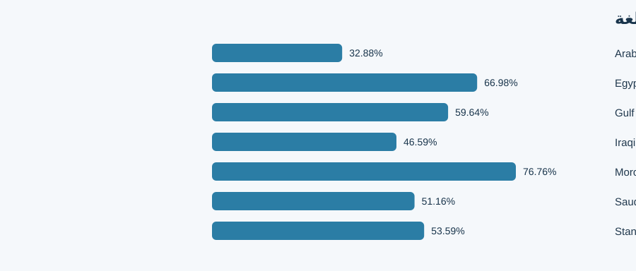
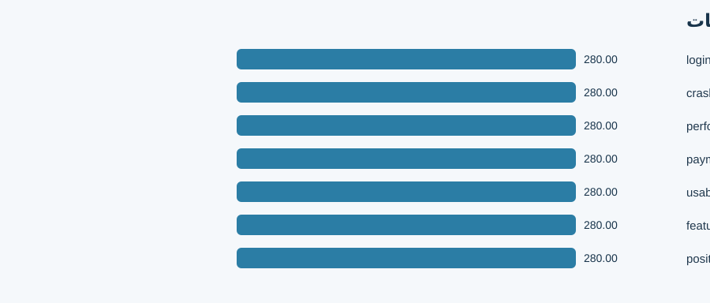

# صدى | Sada Reviews — تقرير التجارب

## الملخص التنفيذي
حلّلنا **1,960 مراجعة اصطناعية** موزعة بالتساوي على 7 أنواع مراجعات و7 شرائح لغوية: سعودي، مصري، مغربي/دارجة، خليجي، عراقي، إنجليزي، وArabizi. قارنا خط أساس للكلمات بخط أساس لمقاطع الأحرف. في اختبار الصيغ المعاد كتابتها، حقق مقاطع الأحرف Macro-F1 قدره **0.588** مقابل **0.375** للكلمات (فرق +0.213).

## السؤال التجريبي
هل تساعد مقاطع الأحرف على تصنيف مراجعات التطبيقات القصيرة والمتنوعة كتابيًا مقارنة بميزات الكلمات؟

## إعداد التجربة
- البيانات: 1960 مثال مولّد يدويًا، 980 تدريب و980 اختبار. كل فئة ولهجة متوازنة (280 لكل فئة ولهجة).
- التقسيم يحجز صياغة بديلة كاملة لكل فئة ولهجة للاختبار؛ لذلك لا تتكرر الجملة نفسها بين التدريب والاختبار. لكنه يظل اختبارًا اصطناعيًا منظمًا، لا اختبارًا على مراجعات حقيقية.
- Word NB يستخدم unigram وbigram. Character NB يستخدم مقاطع أحرف بطول 2–4، وكلاهما Multinomial Naive Bayes.
- المقياس الأساسي Macro-F1 لأنه يوازن الفئات، مع Accuracy للمقارنة.

## النتائج على الاختبار الاصطناعي
| خط الأساس | Accuracy | Macro-F1 |
|---|---:|---:|
| Word n-grams + Multinomial NB | 0.413 | 0.375 |
| Character n-grams + Multinomial NB | 0.593 | 0.588 |

## Macro-F1 حسب الشريحة اللغوية — أفضل خط أساس
| الشريحة | Macro-F1 |
|---|---:|
| Arabizi | 0.329 |
| Egyptian Arabic | 0.670 |
| Gulf Arabic | 0.596 |
| Iraqi Arabic | 0.466 |
| Moroccan Darija | 0.768 |
| Saudi Arabic | 0.512 |
| Standard English | 0.536 |

## اختبار استبعاد لهجة كاملة من التدريب
هذا اختبار ضغط مستقل: نعيد التدريب سبع مرات، وفي كل مرة نستبعد لهجة واحدة بالكامل ثم نقيسها. يكشف اختلاف اللغة أكثر صعوبة من تقسيم الصيغ البديلة.

| اللهجة المستبعدة | Word Macro-F1 | Character Macro-F1 |
|---|---:|---:|
| Arabizi | 0.250 | 0.342 |
| Egyptian Arabic | 0.986 | 0.986 |
| Gulf Arabic | 0.922 | 1.000 |
| Iraqi Arabic | 1.000 | 1.000 |
| Moroccan Darija | 0.924 | 1.000 |
| Saudi Arabic | 1.000 | 1.000 |
| Standard English | 0.282 | 0.290 |

## توزيع البيانات ومصفوفة الالتباس

## ماذا تعني النتائج؟
- مقاطع الأحرف تفوقت في هذا الاختبار الاصطناعي، وهذا يتسق مع قدرتها على التقاط اختلافات التهجئة واللواصق. النتيجة تخص هذه العينة فقط.
- يظهر Arabizi والإنجليزي كأصعب شريحتين في اختبار استبعاد لهجة كاملة؛ Macro-F1 لـCharacter NB هو 0.342 و0.290 على الترتيب. يحتاجان بيانات تدريب أكثر تنوعًا.
- النتائج العالية في استبعاد لهجات عربية أخرى لا تعني تعميمًا حقيقيًا؛ صياغاتنا مولدة من قوالب قليلة ومتوازنة.

## CAMeLBERT fine-tuning
CAMeLBERT-Mix هو النموذج الأساسي المخطط للتطبيق. دفتر Colab في notebooks/camelbert_finetuning.ipynb يضبطه على فئات المشروع ويقيّم Macro-F1 وAccuracy حسب اللهجة واللغة. لم يُشغّل التدريب بعد، لذلك لا توجد نتائج CAMeLBERT منشورة؛ الأرقام أعلاه تخص خطوط الأساس فقط.

## القيود والخطوات التالية
1. جمع مراجعات منشورة من مصدر يسمح بإعادة الاستخدام، وتوثيق المصدر وتاريخ الجمع.
2. إزالة أسماء المستخدمين والبريد وأرقام الجوال والروابط قبل التحليل.
3. وضع دليل تصنيف واضح، ثم مراجعة عينة يدويًا بواسطة شخصين ومقارنة الاتفاق.
4. إعادة التجربة بتقسيم مجموعات حسب التطبيق ومصدر المراجعة، حتى لا يتعلم النموذج مفردات تطبيق واحد.
5. مقارنة الخطوط الأساسية بنموذج Transformer عربي/متعدد اللغات بعد توفر بيانات حقيقية كافية.

> **تنبيه:** جميع الأرقام هنا نتائج فعلية من تشغيل التجربة على بيانات اصطناعية مولّدة لهذا المشروع. لا تمثل أداءً على مراجعات متجر حقيقية، ولا تصلح لوصف النموذج بأنه جاهز للإنتاج.
